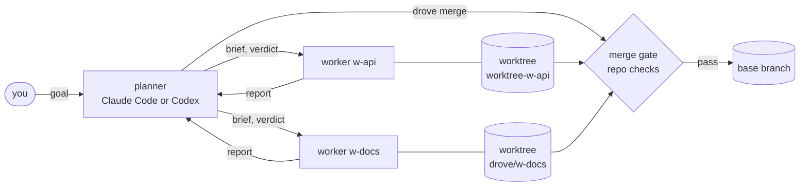

# drove

[](https://github.com/montytorr/drove/actions/workflows/ci.yml) [](LICENSE)

Run a team of Claude Code and Codex agents on one repo: a planner that delegates and reviews, workers that each code in their own git worktree, and a merge gate that only lands checked work.

One coding agent at a time is slow, and several in one checkout trip over each other. Drove gives each worker its own [herdr](https://herdr.dev) pane, worktree and branch, and one Cairn task to claim and report on. The planner splits the goal, briefs the workers, reads their diffs and answers their questions.

Nothing lands by hand: `drove merge` runs the repo's checks on the exact commit it merges. You watch the run on one board and step in only when a worker needs a person.

```text
◆ drove APP-41: Rate-limit the public API                 ▰▰▰▱▱ 1/3 done · 3/5 open · 42m

⌘   lead         Opus 5.5 · h  waiting on w-docs                                       3m
├─ ▌ ✓  w-api       chk✓ Sonnet·m  APP-42   merged · checks reused: passed at 4e1c9a2  5m
├─ ▌ ⚙  w-docs      chk~ Sonnet·m  APP-43   ⠋ editing docs/limits.md                  12m
└─ ▌ ?  w-review  R      codex·h   APP-42   needs an approval in its pane              1m

── timeline ────────────────────────────────────────────── drove-20261013-0834-75b7 ──
10:51 ➤  ⌘           → w-api       brief     Add a token-bucket limiter to /v1/*, with tests
11:20 ✓  w-api       → ⌘           done      limiter + 14 tests; AC1–AC3 met
11:21 ✎  ⌘           → w-api       verdict   approve: commit src/limit.ts and test/limit.test.ts
11:33 ?  w-review    → ⌘           question  The limiter reads X-Forwarded-For: trust it?
```

That is `drove board` in a spare pane. The same board runs inside Claude Code with the mod and in a browser with `drove board --web`.

## How it works



- **herdr** is the terminal multiplexer Drove runs on: every agent is a herdr pane Drove can start, read and type into.
- **Cairn** is the task tracker and shared memory. Each worker claims one Cairn task, notes what it found and leaves the task in review, so the work outlives the pane.
- **A seat** is one worker slot in a run: a name (`w-api`), an agent kind, a model, a pane, a worktree and a branch.
- **The mod** is Drove's Claude Code plugin (`mod/`): it turns a Claude Code session into a planner with a board, in-app dialogs and per-request model switching.

A worker's life:

1. **Spawn.** The planner names a seat, a kind, a Cairn ref and a brief. Drove checks the task is open, opens a pane, starts the agent, and sends the brief once the worktree is in place.
2. **Work.** The worker edits only its worktree (branch `worktree-<seat>` for Claude, `drove/<seat>` for Codex) and never pushes.
3. **Report.** It calls its `report` tool: `done`, `question`, `blocked`, `promote` or `progress`. Anything but `progress` wakes the planner.
4. **Verdict.** Drove first runs the repo's fast checks on a `done`. The planner then reads the diff and sends `approve` or `changes`; after an approve the worker commits its own paths.
5. **Merge, then close.** `drove merge <seat>` runs the checks and merges `--no-ff` into the base, or goes through a pull request with `--pr`. The planner then closes the seat.

There is no daemon. The planner's own MCP server (or, for a Claude planner with the mod, a child process of the mod) reads each worker's report file and wakes the planner. Run state is plain files under `~/.drove`. [DESIGN.md](DESIGN.md) has the protocol, launch specs and the reasons behind them.

## Requirements

- **[Cairn](https://cairn.montytorr.com)**, signed in. Drove has no work queue of its own: every worker is spawned with one Cairn task ref (`--cairn APP-12`) and claims it. The planner's tool calls keep the run's own Cairn claim alive (at most one `cairn beat` every 10 minutes), so a long run does not lose its task.
- Node 22.18 or newer. Drove runs its TypeScript directly, so there is no build step.
- herdr 0.9 or newer, with its server running. An attached planner runs inside a herdr pane (`HERDR_ENV=1`).
- `claude` and/or `codex` on `PATH`, signed in.
- `gh`, signed in, only for `drove merge --pr`.

`drove doctor` checks all of this and prints a one-line fix for anything missing.

## Install

```sh
npm install      # dev dependencies only: typescript, @types/node
ln -sf ~/src/drove/src/cli.ts ~/.local/bin/drove   # the path of your clone; any directory on PATH
```

The symlink is the recommended way: it survives `nvm use`. `src/cli.ts` is executable and runs under whichever `node` is on `PATH`, which must be Node 22.18+.

`npm link` from the repo also works, but under nvm a link exists for one Node version only. Do not install globally: Node does not strip types from files under `node_modules`.

### The Claude Code mod (optional)

`drove plan` works without it. The mod (`mod/`, plugin name `orchestrator`) adds `/orchestrate`: a Claude Code session becomes the planner with the `*_worker` tools, a board inside Claude, in-app dialogs, and model and effort switched on each request. In a `drove plan` session it adds `/orchestrate board`.

Claude Code loads it from `CLAUDE_CODE_PLUGIN_DIRS` in the `env` block of `~/.claude/settings.json`. The value is a list of directories separated by `:`; append your clone's `mod` directory to any existing value:

```json
{
  "env": {
    "CLAUDE_CODE_PLUGIN_DIRS": "/Users/you/src/drove/mod"
  }
}
```

Restart Claude Code, then type `/orchestrate help`: it answers when the mod is loaded. Drove reads this same setting when it launches a Claude worker, and always keeps the `orchestrator` mod in a worker's plugin dirs, even when [`workerPlugins`](docs/lean-workers.md) trims the rest.

Releases are on the [GitHub releases page](https://github.com/montytorr/drove/releases); [CHANGELOG.md](CHANGELOG.md) says what changed in each.

## Quick start

Pick a planner. `drove plan` needs a terminal of its own: a fresh herdr pane, not one already hosting another agent or another run's planner.

| Planner | Start it with | What you get |
|---|---|---|
| Claude Code, with the [mod](#the-claude-code-mod-optional) | `/orchestrate <goal>` in a Claude session in a herdr pane | A board inside Claude, model and effort switched on each request, in-app dialogs |
| Claude Code, without the mod | `drove plan --kind claude` | Woken by a channel (a research preview in Claude Code) or by keystrokes |
| Codex | `drove plan --kind codex` | Woken by `codex queue`; the sixth-pane budget is asked through MCP elicitation |

All three, the sixth-pane dialog in Claude and in Codex, two runs side by side and signed messages in both kinds of worker have been exercised in live runs.

```sh
drove plan --kind claude --goal "Rate-limit the public API"
drove plan --from-cairn APP-12   # the goal is that Cairn task's title and body
drove plan --next APP            # the goal is the top task `cairn next --project APP` ranks
drove plan --from-cairn LAB-21     # a Lab subject: one worker per open todo
drove board                        # in a spare pane
```

`drove plan` creates a run, records the pane as the planner pane and replaces itself with `claude` or `codex`, with Drove's MCP server, guard hooks and role text attached. From inside another agent, or from a job with no pane, use `drove plan --detached` ([unattended runs](docs/unattended.md)).

**The goal.** Without `--goal`, the first prompt you type becomes the goal (its first line, up to 120 characters). The planner keeps it true afterwards with `set_goal` (`drove goal`) when it is vague or your ask moves on; the board header shows it.

**Runs from Cairn.** `--from-cairn` and `--next` need an open task; `--goal` cannot be combined with them. The planner holds that task, and `drove down` writes a summary note on it: seats, branches, cost and rework, what is still open.

**Lab subjects.** `--from-cairn LAB-21` reads the subject from the `croft` instance (`labInstance` changes it). The goal is "LAB-21: <title>", each open todo gets a worker spawned with its own ref, and the run never closes the subject: that needs your conclusion.

**The mod.** `/orchestrate <goal>` turns the session into the planner, with the tools `spawn_worker`, `message_worker`, `review_verdict`, `promote_worker`, `demote_worker`, `migrate_worker`, `merge_worker`, `run_checks`, `close_worker`, `set_goal`, `set_owns`, `read_reports` and `roster`. `/orchestrate` again re-attaches; `/orchestrate board` in a `drove plan` session shows that run's board.

## What you get

- **A merge gate.** Branches land only through `drove merge`, behind the repo's checks, at the commit that was checked. Drove checks a `done` report before the planner reads it. [The merge gate](docs/merge-gate.md)
- **Reviewer and tester seats.** A read-only reviewer from the other model, or a tester that writes tests against another seat's branch. [Reviewer and tester seats](docs/merge-gate.md#reviewer-and-tester-seats)
- **Guard rules.** Workers never push, the planner never edits code, `--owns` limits what a worker may touch, and every refusal says what to do next. [Guard rules](docs/guard-rules.md)
- **Unattended runs.** A cron job, webhook or chat command can start, watch and resume a run, with stable JSON and failure codes. [Unattended runs](docs/unattended.md)
- **Remote hosts.** Run Drove on a client's laptop, a dev box or a CI host, with a setup checklist. [Running Drove on another machine](docs/remote-hosts.md)
- **Lean workers.** Choose Claude or Codex per worker, and trim the MCP servers, plugins, skills, agents, memory and hooks each one loads. [Lean workers](docs/lean-workers.md)
- **Isolation beyond a worktree.** Per-seat ports, environment and copied `.env` files. [Isolating workers](docs/isolation.md)
- **Observability.** Boards in the terminal, in Claude and in a browser; cost and rework reports; diagnoses; OpenTelemetry traces. [Observability](docs/observability.md)
- **Clean exits.** Ctrl-C, SIGTERM and SIGHUP stop the process groups of running commands, including children that ignore SIGTERM. A command that times out gets SIGTERM, then SIGKILL 3 seconds later.

## Commands

| Command | Use |
|---|---|
| `drove plan [--kind claude\|codex] [--model M] [--effort E] [--goal TEXT \| --from-cairn REF\|LAB-n \| --next PROJECT] [--run ID] [--detached [--json]]` | start a planner in this pane; `--detached` opens a herdr workspace of its own and returns at once |
| `drove spawn <seat> [--kind claude\|codex] --cairn REF --brief TEXT\|- [--model M] [--effort E] [--base BRANCH] [--mcp NAMES] [--plugins NAMES] [--skills NAMES] [--agents NAMES] [--user-memory on\|off] [--user-hooks on\|off] [--role implementer\|reviewer\|tester --target SEAT] [--owns GLOBS] [--acceptance TEXT ...] [--max-turns N] [--max-tokens N] [--max-minutes N] [--max-cost USD]` | open a worker in its own worktree and pane, and brief it; each `--acceptance` is a criterion numbered AC1…ACn that the worker answers in its done report |
| `drove send <seat> --kind message\|answer\|verdict [--verdict approve\|changes] [--expects review\|answer\|none] [--run ID] TEXT\|-` | send one signed control message; `--run` names the run from outside it |
| `drove prompt <seat> TEXT\|-` | raw prompt into a seat of this run (guarded) |
| `drove promote <seat> [--model M] --effort E [--reason TEXT]` | change a worker's model or effort |
| `drove migrate <seat> --kind claude\|codex [--model M] [--effort E] [--reason TEXT]` | move a worker to the other kind in the same worktree, with a handoff brief |
| `drove owns <seat> --add GLOBS \| --set GLOBS [--run ID]` | widen or replace an open worker's owned paths mid-run |
| `drove init <dir> [--json]` | make a new git repo (branch `main`, one empty commit) in an empty or missing directory |
| `drove roster [--json] [--run ID]` | one line per seat; `--json` adds the run status, the planner's state and the latest report |
| `drove reports [<seat>] [--all] [--json] [--run ID]` | the workers' reports in full: those not yet read (a seat's latest when none is unread), or every report with `--all` |
| `drove report [<run>] [--json]` | tokens, cost, wall time, human wait, rework, checks, guard denials and nudges, per seat and in total |
| `drove diagnose [<run>] [--json]` | why a run needed rework and where the fix belongs |
| `drove trace [<run>] [--json] [--otlp URL]` | the run as an OpenTelemetry span tree |
| `drove attention [--run ID \| --all] [--json] [--follow]` | what waits on a person, as data; `--follow` streams JSON lines |
| `drove capture <seat> [--lines N] [--run ID]` | read a seat's recent output |
| `drove merge <seat> [--pr] [--squash] [--fresh] [-m MSG] [--run ID]` | land a worker's branch behind the repo's checks, locally or through a pull request |
| `drove checks <seat> [--fresh] [--run ID]` | run (or reuse) the merge plan's checks in a seat's worktree; never writes to the repo |
| `drove close <seat> [--remove-worktree]` | stop a worker and close its pane |
| `drove board [--once] [--web [--port N]] [--run ID]` | the live board in a pane, one frame with `--once` or when piped, or read-only in a browser with `--web` |
| `drove down [--run ID]` | save every session id and stop the run |
| `drove up [--run ID] [--seat SEAT] [--detached [--json]]` | resume a run, relaunch one dead seat, or relaunch a lost planner |
| `drove goal [--run ID] [--cairn REF] <text>\|-` | set the run's goal (the planner or the human; a worker is denied) |
| `drove policy [--run ID] [--json]` | the merged `spawnPolicy` and its errors, read from the committed run base |
| `drove doctor [--json]` | check what this machine needs; exits 1 when a check fails; read-only |
| `drove budget <n> [--run ID]` | raise the pane budget (the human only) |
| `drove guard <event>`, `drove mcp`, `drove mod attach\|bridge\|report` | entry points for hooks, MCP and the mod |

`drove --help` prints the same list. The planner's MCP tools are `spawn`, `send`, `verdict`, `prompt`, `promote`, `migrate`, `close`, `merge`, `run_checks`, `roster`, `capture`, `set_goal`, `set_owns`, `run_report` and `down`. A worker has one tool, `report`. They call the same functions as the CLI.

## Configuration

State lives in `~/.drove` (`DROVE_HOME` overrides it): one folder per run with `roster.json`, `events.jsonl`, `checks.jsonl`, a `codex-home/`, and a folder per seat with its token, report file and launch spec.

`~/.drove/config.json` is yours and applies to every run. `.drove.json` is the repo's own, read from the main checkout, and wins where a key can be set in both. Defaults are in `src/commands.ts`.

| Key | Where | Default | What it does |
|---|---|---|---|
| `plannerModel`, `workerModel`, `promotedModel` | `config.json` | Claude: Opus 5.5, Sonnet 5.5, Opus 5.5; Codex: your default | model per agent kind, as `{"claude": "…", "codex": "…"}` |
| `plannerEffort`, `workerEffort` | `config.json` | `high`, `medium` | default effort |
| `workerKind` | `config.json` | `auto` | the kind a spawn gets when it names none: `auto` (Claude when installed), `claude` or `codex` |
| `budget` | `config.json` | 5 | worker panes before the human must say yes |
| `humanName` | `config.json` | "the human" | how reports for you are addressed |
| `briefVia` | `config.json` | `prompt` | `prompt` sends the brief after the agent is up; `launch-arg` passes it at launch |
| `briefPointerLines` | `config.json` | 40 | a longer brief goes as a signed pointer to the seat's `brief.md` |
| `claudeChannel` | `config.json` | `false` | wake a Claude planner without the mod through the development channel instead of keystrokes |
| `codexWorkerSandbox` | `config.json` | `bypass` | `workspace-write` runs Codex workers in Codex's sandbox |
| `codexBypassHookTrust` | `config.json` | `false` | let Codex seats skip the hook-review question for Drove's hooks |
| `labInstance` | `config.json` | `croft` | the Cairn instance that holds Lab subjects |
| `workerEnv`, `workerPorts`, `workerCopy` | `config.json` | unset | per-seat environment, ports and copied files ([isolation](docs/isolation.md)) |
| `workerMcp`, `workerPlugins`, `workerSkills`, `workerAgents`, `workerUserMemory`, `workerUserHooks` | `config.json` | everything loaded | what a Claude or Codex worker loads ([lean workers](docs/lean-workers.md)) |
| `spawnPolicy` | either | unset | rules on what the planner may give a worker ([lean workers](docs/lean-workers.md#spawn-policy)) |
| `checks` | `.drove.json` | the repo's `typecheck`, `lint`, `test` scripts or Makefile targets | what the merge gate and `drove checks` run |
| `autoCheck` | either | on | `false` in either file stops Drove checking a `done` report itself |
| `autoChecks` | `.drove.json` | the merge plan's `checks` | a faster list for that check; `[]` turns it off |
| `autoCheckAttempts` | either | 2 | failed auto-checks sent back to the worker before the planner is woken |
| `maxTurns` | `config.json` | unset | turn budget for every worker; `--max-tokens`, `--max-minutes`, `--max-cost` are per spawn |
| `reviewLoopLimit` | `config.json` | 3 | `changes` verdicts to one seat before a `review-loop` attention |
| `runMaxCost` | `config.json` | unset | USD bound on the whole run; over it raises one `run-budget` attention |
| `guardThrash` | `config.json` | `{"count": 3, "minutes": 10}` | repeated denials of one rule that raise `guard-thrash` for the planner |
| `steering` | `config.json` | `{"enabled": true, "repeatFailures": 3, "cooldownMinutes": 10, "checkCommands": []}` | the R1 and R2 steering rules ([guard rules](docs/guard-rules.md#steering)) |
| `otlpEndpoint` | `config.json` | unset | collector URL; `drove down` exports the run's trace there |

## Known limits

- **Codex sessions of a Drove run live under the run's `codex-home/`**, not `~/.codex`, so `codex resume` outside Drove does not see them.
- **Claude picks its own worktree base.** Claude creates its worktree from `origin/main`; `spawn` then fast-forwards it to the freshest of local `main` and `origin/main`, so unpushed local work is included. `--base` is ignored for Claude seats, and a worktree that diverged is left as is, with a note.
- **The channel prints a cosmetic line.** A Claude planner on the development channel shows `server:drove · no MCP server configured with that name` at launch and works anyway. The channel asks for one confirmation per launch, and an idle session takes a turn when a report arrives.
- **Codex may ask once to approve Drove's hooks.** The Codex planner, and a Codex seat with no Drove-owned home, can show that dialog in the pane. Drove never answers it, and shows it on the board.
- **The mod cannot import Drove's code.** It runs the CLI, so Node 22.18+ must be on `PATH` (or set the mod's `nodePath`).
- **Isolation stops at the worktree.** A container or VM per seat is not built ([isolating workers](docs/isolation.md)).

## Develop

```sh
npm install
npm test            # node:test, test/**/*.test.ts
npm run typecheck   # tsc --noEmit
```

Run `npm test` in a normal shell. Inside a Drove worker `DROVE_*` is set, and `test/mod-protocol.test.ts` fails on it unless you unset those variables.

The mod's tests run only through Claude Code. A Drove worker's guard allows exactly this `claude` command:

```sh
claude plugin test mod
```

If `claude` is a shell function or wrapper, call the real binary (for example `~/.local/bin/claude`); a wrapper that adds flags before `plugin` breaks it. The mod's type check needs the generated `mod/.claude-plugin/types`, which is not in the repo.

## Why the name

A drove is a herd driven together, and the drover drives it: Drove runs on herdr and keeps one planner's workers moving. Drove roads were the old Scottish cattle routes the drovers walked to market, which fits the names in this family (Bothy, Cairn, Croft, Trig, Holloway).

## License

[MIT](LICENSE). To report a security issue, see [SECURITY.md](SECURITY.md).
